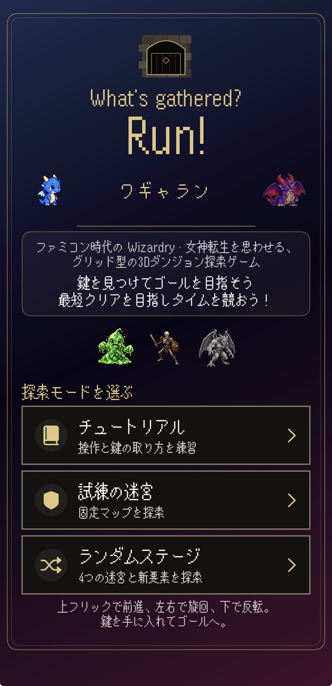
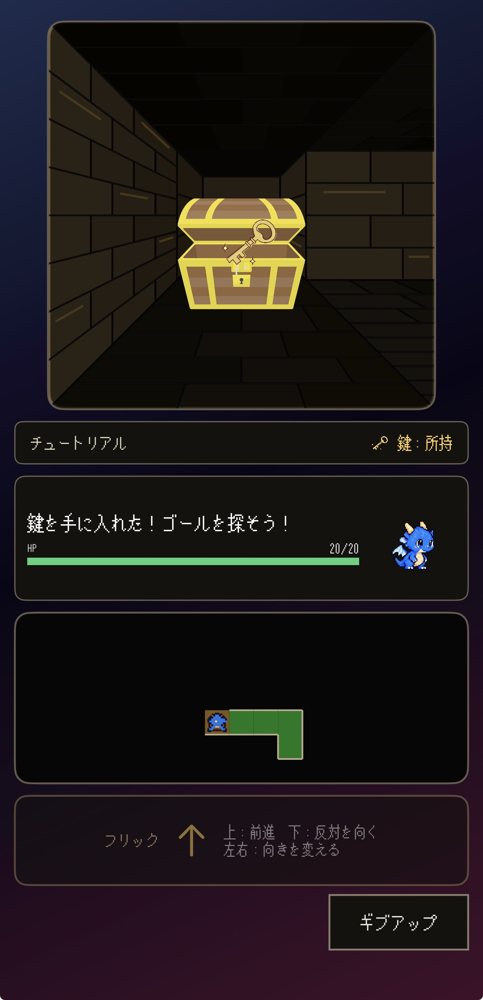
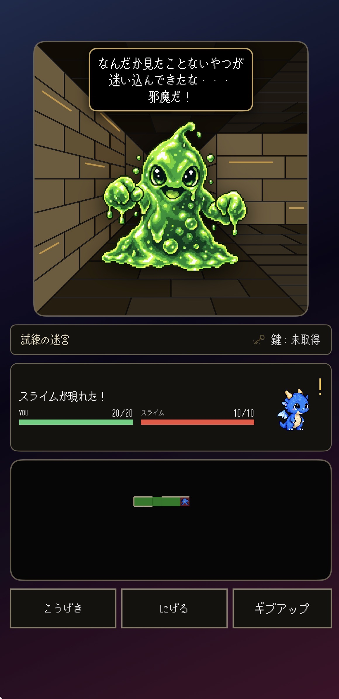
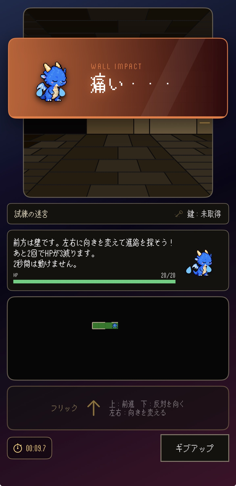
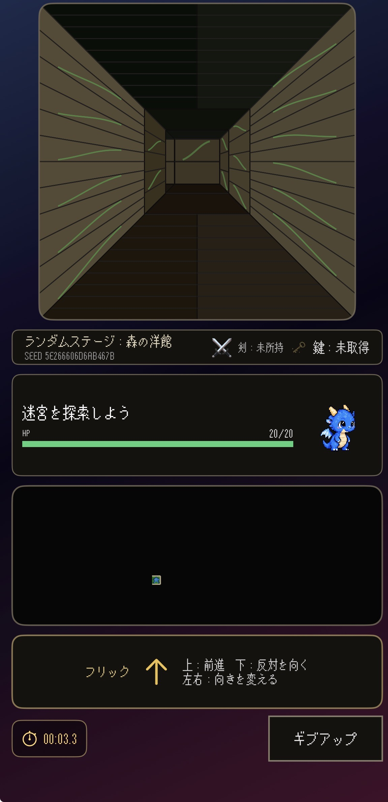
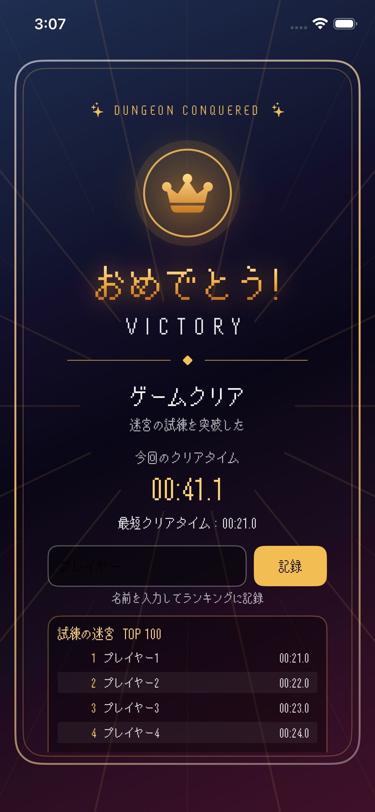

# 日専祭アプリ：（ワギャラン）

> **チーム：** Aチーム（26CM0101　安住 光司、26CM0120 竹岡修一、26CM0130 三浦 崇志）
> **AI利用レベル：** 2（生成コード可）
> **最終更新：** 2026-10-19

> 💡 制作の進め方は担任の先生から案内があります。このファイルの項目は、担任の先生の指示で増えることがあります。

---

## 何ができるアプリか（3行）
古典的な3DダンジョンRPG(ウィザードリィ風)の探索を擬似的に体験できます。画面上のボタンでプレイヤーの方向転換や前進を操作し、前方の壁の確保を確認できます。画面下部にある2Dミニマップで自分の歩行とゴールまでの経路を入力して確認できます。

## 画面

| タイトル画面 | 鍵と宝箱 |
| --- | --- |
|  |  |
| チュートリアル・試練の迷宮・ランダムステージから、遊ぶモードを選びます。 | ダンジョンを探索して宝箱を見つけ、ゴールを開くための鍵を手に入れます。 |

| 戦闘画面 | カットイン |
| --- | --- |
|  |  |
| 敵との戦闘中にHPを確認し、「こうげき」や「にげる」を選びます。 | 敵との遭遇やトラップ発動時に、キャラクターのリアクションを表示します。 |

| ランダムステージ | ゲームクリア |
| --- | --- |
|  |  |
| シード値から生成された迷宮を探索し、鍵を手に入れてゴールを目指します。 | ゴールに到達すると、クリア演出を表示し、クリアタイムのユーザー登録を促します。 |

## 使った文法・技術

struct・let・var・Bool型,guard文とOptional型

## 生成AIの使い方（どの場面で、どう使ったか）

画像生成やBGMはGemini 基本的なコーディングはCodex　検証・評価にClaude,Cursorを使いました。
GithubのCIテストやプルリクエスト作成をAIにやらせた部分もありますがGithub Desktopを用いたときもあります。
なるべく一回のプロンプトで実現したい機能の要望をたくさん書いたり、Claudeからのレビューを元に次の作業を決定したりすることがありました。

## 展示で工夫した点

（例：文字を大きくして、来場者が操作しやすいようにした。）
